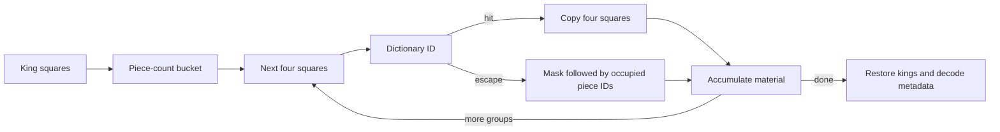

# Record and block codec

### Board coordinates and traversal

Use square number `8 * rank + file`, with a1 = 0. Rank and file are zero-based. Piece IDs in order are `P p N n B b R r Q q K k empty` (0 through 12). Emit the white king square, then the black king square using a table selected by the white king rank. Clear both king squares in the working board. Emit `phase = min(7, nonking_count / 8)` using integer division.

Each file contributes two groups. This diagram gives their group IDs. Within a group, visit squares from the lowest rank upward.

```text
rank      a   b   c   d   e   f   g   h
8–5       1   3   5   7   9  11  13  15
4–1       0   2   4   6   8  10  12  14

group 0 = [a1,a2,a3,a4]       group 1 = [a5,a6,a7,a8]
group 2 = [b1,b2,b3,b4]       last    = [h5,h6,h7,h8]
```

Each group owns a dictionary shared by all phases. Pack four IDs into a u32 with the first square in the low byte. Rank observed words by descending count, breaking ties by descending unsigned packed word. Keep the first 127 distinct words. A hit emits its zero-based ID. A miss emits 127, a four-bit mask and one piece symbol for each set bit in ascending bit order. For example, if group 0 contains a white rook, an empty square, a black pawn and an empty square, its word is 0x0C010C06. On a miss emit 127, mask 5, then IDs 6 and 1. Its signed material contribution is +4. Cache that contribution alongside each decoded dictionary word.



### Metadata and table order

Use weights 1, 3, 3, 5, 9 for pawn, knight, bishop, rook, queen. Sum white material minus black. Decode state as one symbol with black-to-move in bit 0 and K,Q,k,q in bits 1 through 4. EP is the square ordinal or 64 for absent. Flip the material sign for black to move, clamp to [-5,5], and add 5 to obtain context C. Result symbol R is signed result + 1, or 3 for a position without a game result (a search-tree sample, stored in binpacks with ply 9999 and a placeholder result). Emit the high byte H of the score's 16-bit two's-complement representation first, then its low byte. Preserve all bit patterns.

The following is also the model serialization order. Within each family enumerate selectors lexicographically, leftmost selector slowest. Symbol numbering starts at zero.

| Family | Selectors | Alphabet size |
|---|---|---:|
| White king | global | 64 |
| Black king | white king rank 0..7 | 64 |
| Phase | global | 8 |
| Group token | phase 0..7, group 0..15 | 128 |
| Escape mask | phase, group | 16 |
| Literal | phase, file-major square 0..63 | 12 |
| State | global | 32 |
| EP | global | 65 |
| Result | C in 0..10 | 4 |
| Score high | C, R in 0..3 | 256 |
| Score low | H in 0..255 | 256 |

Literal IDs 10 and 11 are reserved by the model and invalid in the stream. Reject a decoded king collision, occupied king destination, missing dictionary ID, or a phase inconsistent with the reconstructed board. File-major square index is four times the group ID plus the offset within it.

### Training and integer coding

Pass one counts dictionary words after removing kings. Freeze the dictionaries. Pass two projects the same training records into the exact symbol sequence above and counts each table independently. Use separate held-out records to measure size. For alphabet size n, total count T, and cumulative observed count P before symbol i, allocate frequency

```text
1 + floor((P + count[i]) * (1024-n) / T) - floor(P * (1024-n) / T)
```

For T=0 substitute count[i]=1, T=n and P=i. Use wide intermediates and checked counters. Frequencies are positive and sum to 1024. Prefix sums give start s. For each slot s+k in the 1,024-entry decode table store the symbol, frequency f and offset k. Build lookup tables once and share them across workers.

For one block collect (table, symbol) pairs in logical decoder order. Start unsigned state x at L = 1<<23. Visit pairs in reverse. While x >= f * (1<<21), append the low byte of x to a temporary stack and shift x right eight. Update x to (x/f)*1024 + x%f + s. Write the final state as little-endian u32 followed by stack bytes in reverse append order.

The decoder reads the state, indexes the selected table at x & 1023, and sets x = f*(x>>10) + k. While x < L, shift x left eight and append the next input byte. At the declared record count require x=L and all payload bytes consumed. Reject truncation before refill. A simple arithmetic test uses f=512,s=512 and initial x=L. One symbol yields state 16777728, no refill bytes, and decoding restores L. Use wide arithmetic for bounds and validate the initial state lies in [L,256*L).

### Correctness checks

Test dictionary hit and escape paths for every group, mask bits 0 and 3 together, every castling flag, EP absent and present, both players to move, promoted material, every result including no result, and scores -32768, -1, 0 and 32767. Compare scalar and optimized implementations on identical payloads. Generate golden files with fixed training inputs and exact bytes, then cross-read them in an independent implementation. Exercise one-record blocks and a final partial block.
