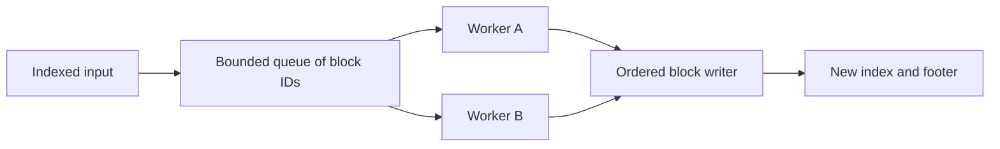

# Rust library, loaders and relabeling

Expose the proposed types under `sfbinpack::four_square`. Retain the existing `CompressedTrainingDataEntryReader` for importing legacy data. Use an explicit projection because the two record types carry different information. A loader can consume a dense board directly without constructing FEN strings.

### API contracts

The signatures below describe the intended public surface. `Result<T>` uses the module's typed error. `BoardState` contains a rank-major array of 64 piece IDs, side to move, castling rights and EP. `Labels` contains an i16 score and a four-valued outcome (loss, draw, win, or no result for search-tree samples), both relative to side to move. Use checked constructors for public inputs. Keep model representation private.

```rust
pub struct Record { pub board: BoardState, pub labels: Labels }
pub struct Model { /* immutable compiled tables */ }
pub struct Dataset<S> { /* source, header, model and index */ }
pub struct Worker { /* reusable compressed and decoded buffers */ }

impl Record {
    pub fn project(entry: &sfbinpack::TrainingDataEntry) -> Result<Self>;
}
impl Model {
    // Open a fresh iterator on each of the two training passes.
    pub fn train<I>(open: impl FnMut() -> Result<I>) -> Result<Self>
    where I: Iterator<Item = Result<Record>>;
}
pub trait ReadAt: Send + Sync {
    fn len(&self) -> std::io::Result<u64>;
    fn read_exact_at(&self, offset: u64, dst: &mut [u8]) -> std::io::Result<()>;
}
impl<S: ReadAt> Dataset<S> {
    pub fn open(source: S) -> Result<Self>;
    pub fn records(&self) -> u64;
    pub fn blocks(&self) -> u64;
    pub fn worker(&self) -> Worker;
    pub fn decode_block<'a>(&self, id: u64, worker: &'a mut Worker)
        -> Result<&'a [Record]>;
}
impl<W: std::io::Write> Writer<W> {
    pub fn new(sink: W, model: std::sync::Arc<Model>) -> Result<Self>;
    pub fn push(&mut self, record: &Record) -> Result<()>;
    pub fn finish(self) -> Result<W>;
}
```

Provide `ReadAt` adapters for owned bytes and local files using platform positional I/O. A slice adapter may borrow the input. Offer an iterator over blocks for sequential callers and an explicit record-range reader that trims the first and last decoded blocks. Return an empty range cheaply. Report out-of-range IDs, truncation, invalid model, invalid record, corruption and I/O failures distinctly, with block and local record indices when available. A failed decode exposes no partial batch. A failed write poisons the writer. Return footer or flush errors from finish; dropping an unfinished writer cannot signal success.

### Import and training loader

Use the existing reader's has_next/next loop. Apply any move-, ply-, clock- or score-dependent filtering to the original entry. Project each accepted board and labels and push it to the writer. Projection checks king count, representability of state and label range. Preserve the exact score, including unusual values. Decide whether dataset-specific sentinel scores should be kept at filtering time.

A typical worker loop with the proposed API is:

```rust
let mut scratch = dataset.worker();
for block_id in assigned_ids {
    let records = dataset.decode_block(block_id, &mut scratch)?;
    for record in records {
        batch.push_features(&record.board, record.labels)?;
    }
}
```

Here batch and assigned_ids belong to the application. A worker may reuse scratch as soon as feature extraction finishes. For cross-thread handoff, transfer an owned batch or use a buffer pool. Keep the model and index in one shared Dataset behind an Arc. Give each worker its own source-independent scratch. No process-wide thread pool is required. An application can schedule block IDs on scoped threads, Rayon, or its existing loader pool. Partition one seeded permutation of IDs among workers to cover every block exactly once per epoch. Distinguish reproducible block assignment from completion order.

### Parallel relabeling



Provide a reusable `BlockEncoder::encode(&Model, &[Record]) -> Result<EncodedBlock>` and `OrderedWriter::append(id, EncodedBlock)`. Keep encoded bytes opaque and carry the originating model identity and record count. Check them on append. Reject skipped or repeated IDs and blocks following a short block. The coordinator controls order. The low-level writer can reject out-of-order calls immediately.

Each worker decodes its assigned block, computes replacement labels through a caller-supplied function such as `FnMut(&BoardState, Labels) -> Result<Labels>`, preserves the board and record count, then encodes with the destination model. Worker-local labelers support engines or other stateful evaluators. Convert white-relative labels at the callback boundary. Score and outcome share an entropy stream with the board, so replacing either requires re-encoding the block. The existing model supports every score. For materially different labels, train a replacement model from representative relabeled samples.

Limit dispatch to a window of K consecutive block IDs ahead of the next required output ID. Drain finished tasks into a reorder buffer and commit the longest available prefix. This bounds memory even when the earliest task is slow. On first error, cancel further dispatch, join workers, and surface the failing ID. Write to a temporary destination in the output directory, finish and flush, then publish using the platform's atomic rename semantics. Retrying writes a fresh destination. If crash durability is required, sync the file and containing directory where supported.

### Verification and performance

Compare projection against the existing reader for piece IDs, score sign, result perspective, EP square, and castling flag ordering. Compare single- and multiworker output record-for-record, including a deliberately delayed first block. Exercise empty input, corrupt tables, clipped final payloads, invalid indices, output failures, and cancellation. Fuzz slice-based decoding with bounded allocations and require a typed error on malformed input.

Benchmark release builds using a fixed held-out sample, worker count, CPU model and compiler flags. Report complete records/s, whole-file bytes/record, peak memory, and separately feature batches/s. Time model construction and disk reads separately from warm block decode. Measure 1, 2, 4 and 8 workers with a bounded queue. For relabeling, record label-computation time separately from decoding, encoding and ordered writes. Treat the prototype numbers as a baseline for comparison.
